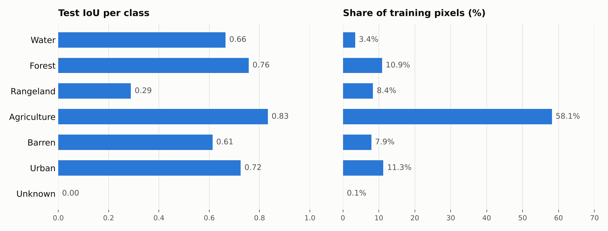

# Land Cover Segmentation with a U-Net

[](https://colab.research.google.com/github/Idris903/geomodel/blob/main/unet_landcover_segmentation.ipynb)

A U-Net built from scratch in PyTorch that classifies every pixel of a satellite image into one of seven land cover types: water, forest, rangeland, agriculture, barren land, urban land and unknown. Trained on the [DeepGlobe 2018 Land Cover](https://www.kaggle.com/datasets/geoap96/deepglobe2018-landcover-segmentation-traindataset) dataset.

## Results

| Metric (held-out test set) | Score |
|---|---|
| **Mean IoU (6 land cover classes)** | **0.647** |
| Mean IoU (all 7 classes) | 0.555 |
| Test loss (cross-entropy) | 0.469 |



- **Best classes:** agriculture (0.83), forest (0.76) and urban land (0.73).
- **Hardest class:** rangeland (0.29). It looks similar to agriculture and barren land from above, and it has far fewer training pixels than agriculture, which makes up 58% of the data.
- **Unknown** is under 0.1% of pixels, so the model never learns it. The DeepGlobe challenge scores mean IoU over the six real classes for the same reason.

## What's in this project

- **U-Net from scratch:** encoder, decoder and skip connections written as `DoubleConv`, `Down` and `Up` blocks, with no pretrained models or segmentation libraries.
- **Data pipeline:** a custom PyTorch `Dataset`, Albumentations augmentation (flips), and an 80/20 train/validation split with a fixed seed so the split stays the same across sessions.
- **Faster data loading:** masks are converted from RGB colours to class IDs once, up front, rather than every time an image is loaded. This cut an epoch from about 20 minutes to about 2 minutes.
- **Efficient training:** mixed precision (`torch.autocast` + `GradScaler`), `torch.compile`, gradient clipping, and checks that stop training if NaN/inf values appear.
- **Checkpointing to Google Drive**, so training resumes across Colab sessions, and a guard that never overwrites a good checkpoint with a broken one.
- **Evaluation:** per-class IoU computed from true positives, false positives and false negatives.

## Debugging story: the NaN test loss

After training, the training loss looked fine but the **test loss was NaN**. The investigation is in [`debugging/nan_investigation.ipynb`](debugging/nan_investigation.ipynb).

1. Only eval mode was broken, which pointed at BatchNorm's **running statistics** (they're only used in eval mode). The running mean and variance in `up1` had become inf/NaN.
2. **Forward hooks** on every layer found the first layer producing a non-finite output: `up1`'s first convolution, which had a **finite input but an inf output**.
3. The weights were fine. The cause was **float16 overflow**: under mixed precision the convolution runs in float16, whose maximum value is 65,504. This layer adds up 1024 × 3 × 3 = 9,216 inputs per output pixel, so the sum overflowed.
4. **Fix:** run `up1` and `up2` in float32 while the rest of the model keeps the float16 speed-up. No layers were added, so existing checkpoints still load.

## How to run

1. Open the notebook in Colab with the badge above and choose a GPU runtime (Runtime → Change runtime type).
2. Add a Kaggle API key so the dataset can download (Kaggle → Settings → Create New Token, then place `kaggle.json` at `~/.kaggle/kaggle.json`). Never commit this file.
3. Run the cells in order. Checkpoints are saved to `MyDrive/deepglobe_checkpoints/` in your Google Drive.

To run locally instead, install the packages in `requirements.txt` and change the data paths and the Google Drive cell.

## Project structure

```
├── unet_landcover_segmentation.ipynb   # data, model, training and evaluation
├── debugging/
│   └── nan_investigation.ipynb         # tracing the NaN test loss to float16 overflow
├── assets/                             # README figures
└── requirements.txt
```

## Next steps

- Class-weighted cross-entropy or Dice loss to help rangeland and the other smaller classes
- A pretrained encoder (e.g. ResNet) to compare against the from-scratch version
- Training on larger image tiles instead of resizing the full 2448 × 2448 images down to 512 × 512

## Tech

Python, PyTorch, NumPy, Albumentations, Matplotlib, Google Colab (NVIDIA T4 GPU)
